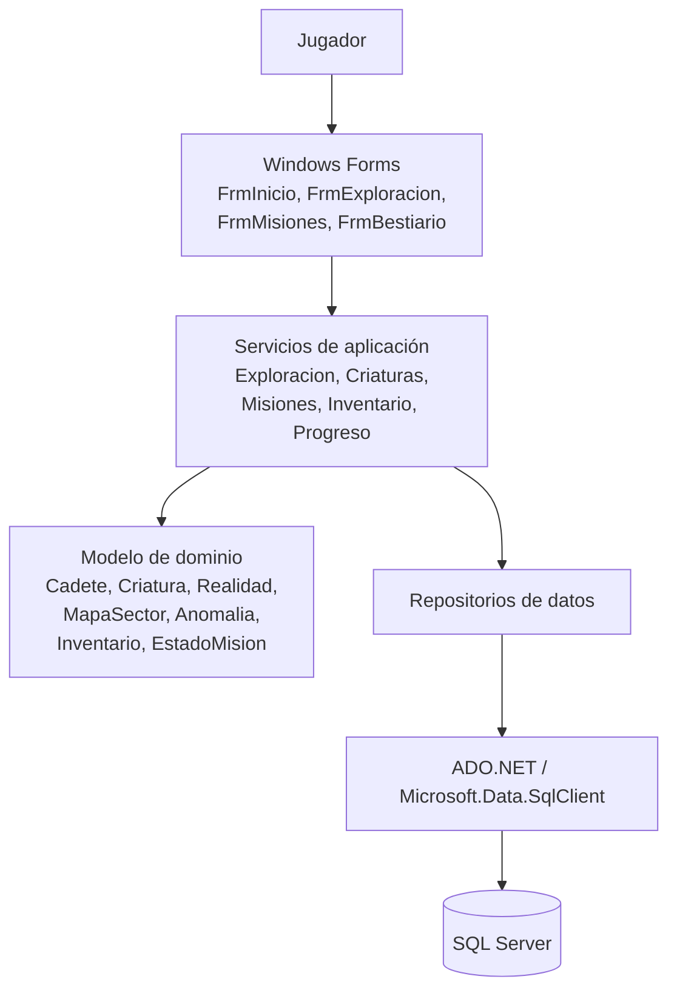

# Arquitectura propuesta para NEXUS gráfico

## 1. Objetivo

Evolucionar el código de H3 hacia una aplicación de escritorio C# con Windows Forms y SQL Server, separando la presentación, las reglas del juego y la persistencia. La separación permitirá cambiar una pantalla sin rehacer las reglas y cambiar la forma de guardar datos sin reescribir la interfaz.

## 2. Capas

### Presentación: Windows Forms

Formularios sugeridos:
- `FrmInicio`: menú principal/Centro NEXUS.
- `FrmExploracion`: mapa, indicadores y acciones contextuales.
- `FrmMisiones`: lista de misiones, objetivos y recompensas.
- `FrmExploradorInventario`: estado del cadete y objetos.
- `FrmBestiario`: criaturas conocidas, pistas y nivel de vínculo.
- `FrmResultadoMision`: resumen y opción para volver al centro.

Responsabilidad: mostrar información, recibir clics/teclas, validar entradas de interfaz y llamar a los servicios. Los formularios no deben ejecutar SQL directamente ni contener reglas como el cálculo de energía.

### Lógica del juego

Servicios sugeridos:
- `ServicioExploracion`: movimiento, casillas y eventos del mapa.
- `ServicioCriaturas`: análisis, encuentros, recomendaciones y vínculo.
- `ServicioMisiones`: comprobar objetivos, extracción y recompensas.
- `ServicioInventario`: uso de objetos y cantidades.
- `ServicioProgreso`: experiencia, habilidades y descubrimientos.
- `EstadoPartida`: estado actual del cadete, realidad, mapa, misión e inventario.

Clases de dominio existentes a conservar y adaptar:
`Cadete`, `Criatura`, `Realidad`, `Anomalia`, `MapaSector`, `Inventario`, `ObjetoInventario`, `RegistroDescubrimientos` y `EstadoMision`. `Personaje`, `Robot` y `Enemigo` pueden conservarse para las interacciones donde sean necesarios.

Los servicios deben devolver resultados o estados que la interfaz pueda mostrar. La lógica del juego no debe depender de `Console.WriteLine`, `Console.ReadLine` o `MessageBox.Show`.

### Acceso a datos

- `ConexionSqlServer` o una configuración central para crear conexiones.
- Repositorios: `RepositorioPartidas`, `RepositorioMisiones`, `RepositorioCriaturas`, `RepositorioInventario` y `RepositorioDescubrimientos`.
- Usar `Microsoft.Data.SqlClient` con `SqlConnection`, `SqlCommand`, `SqlParameter` y `SqlDataReader` cuando corresponda.
- Enviar valores mediante parámetros SQL, no concatenar texto introducido por el usuario.
- Abrir conexiones cerca de la operación y liberarlas con `using`.
- No almacenar contraseñas ni cadenas de conexión privadas en GitHub.

## 3. Diagrama de arquitectura

## 4. Flujo de una acción

Ejemplo: el jugador selecciona una criatura y pulsa **Analizar**.

1. `FrmExploracion` identifica la criatura seleccionada y llama a `ServicioCriaturas.Analizar(...)`.
2. El servicio valida que la criatura exista y que el cadete tenga energía suficiente.
3. La lógica calcula el resultado y actualiza el estado del encuentro, la misión y el descubrimiento.
4. Si corresponde, el repositorio guarda el descubrimiento y el progreso.
5. El servicio devuelve un resultado legible para la interfaz.
6. El formulario actualiza la ficha, la energía, el objetivo y el mensaje de retroalimentación.

## 5. Migración de responsabilidades

| Código H3 | Destino propuesto | Cambio |
|---|---|---|
| `Program.MostrarMenu()` | `FrmInicio` | Convertir opciones de texto en botones/eventos. |
| `Program.ExplorarMapaSector()` y `MoverJugadorMapa()` | `ServicioExploracion` + `FrmExploracion` | Separar movimiento/reglas del dibujo del mapa. |
| `Program.DibujarMapaSector()` y métodos de color | Control/panel gráfico | Renderizar la matriz sin alterar las reglas del mapa. |
| `Program.MostrarEncuentroCriatura()` y `IntentarDomesticar()` | `ServicioCriaturas` + `FrmExploracion`/`FrmBestiario` | Evolucionar domesticación hacia vínculo, de forma incremental. |
| `Program.MostrarInventario()` y `UtilizarObjetoInventario()` | `ServicioInventario` + formulario de inventario | Mantener reglas fuera de la UI. |
| `Program.MostrarMisionActual()` y `VerificarMisionV2()` | `ServicioMisiones` + `FrmMisiones` | Separar definición, estado y presentación. |
| Listas en memoria | Repositorios SQL Server | Guardar progreso de forma persistente. |

## 6. Decisiones de diseño

- **No crear un formulario por cada clic.** Las acciones contextuales se muestran en paneles para mantener una navegación simple.
- **No ejecutar SQL en los formularios.** Evita acoplamiento y facilita las pruebas.
- **No dibujar el mapa dentro de la lógica de movimiento.** `MapaSector` describe el estado; el control gráfico lo representa.
- **No migrar las seis realidades de golpe.** La primera entrega debe demostrar una misión completa en el bosque.
- **No persistir cada movimiento de forma indiscriminada.** Guardar en puntos definidos: cambio importante, final de misión y guardado explícito. Si se requiere recuperación ante fallos, evaluar guardados adicionales.
