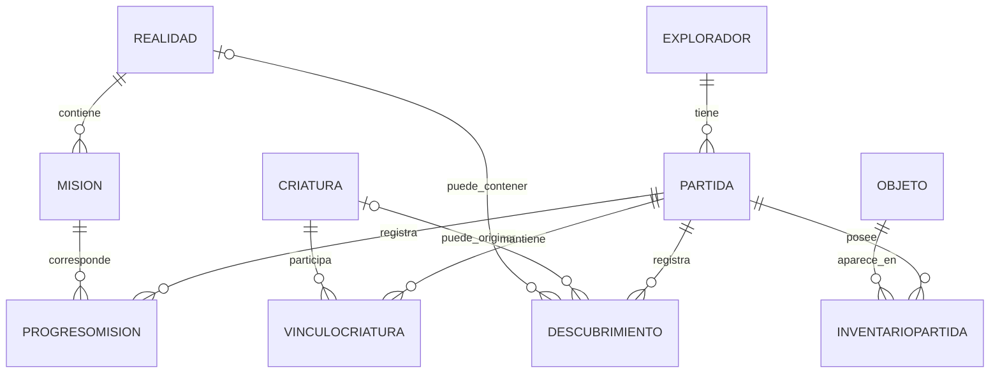

# Modelo de datos propuesto para SQL Server

## 1. Propósito

El modelo persiste el perfil del explorador y el avance narrativo sin convertir cada detalle visual en una tabla. Las criaturas y realidades son datos de referencia; las partidas, misiones completadas, objetos obtenidos y descubrimientos representan el progreso de cada jugador.

Este es un diseño propuesto. El código H3 actual utiliza objetos y listas en memoria; no se observó conexión existente a SQL Server.

## 2. Entidades

| Tabla | Campos principales propuestos | Propósito |
|---|---|---|
| `Explorador` | `ExploradorId` PK, `Nombre`, `Edad`, `FechaCreacion` | Identidad del perfil del cadete. |
| `Partida` | `PartidaId` PK, `ExploradorId` FK, `Nivel`, `Experiencia`, `Energia`, `Estabilidad`, `FechaInicio`, `FechaGuardado`, `Estado` | Estado general de una campaña guardada. |
| `Realidad` | `RealidadId` PK, `Codigo`, `Nombre`, `Entorno`, `Riesgo`, `Descripcion`, `Desbloqueada` | Catálogo de realidades. |
| `Mision` | `MisionId` PK, `RealidadId` FK, `Titulo`, `Descripcion`, `OrdenHistoria`, `Activa` | Definición reutilizable de cada misión. |
| `ProgresoMision` | `ProgresoMisionId` PK, `PartidaId` FK, `MisionId` FK, `Estado`, `ObjetivosCompletados`, `FechaInicio`, `FechaFin` | Estado de una misión dentro de una partida. |
| `Criatura` | `CriaturaId` PK, `Nombre`, `Categoria`, `Entorno`, `Peligro`, `Descripcion`, `Recomendacion`, `EsLegendaria`, `EsVinculable` | Catálogo del bestiario. |
| `Descubrimiento` | `DescubrimientoId` PK, `PartidaId` FK, `CriaturaId` FK nullable, `RealidadId` FK nullable, `Tipo`, `Detalle`, `Fecha` | Pistas, especies y hallazgos descubiertos. |
| `VinculoCriatura` | `VinculoId` PK, `PartidaId` FK, `CriaturaId` FK, `NivelVinculo`, `Estado`, `FechaPrimerEncuentro` | Relación de una partida con una criatura. |
| `Objeto` | `ObjetoId` PK, `Nombre`, `Tipo`, `Efecto`, `Descripcion` | Catálogo de objetos utilizables. |
| `InventarioPartida` | `PartidaId` FK, `ObjetoId` FK, `Cantidad`, PK compuesta (`PartidaId`, `ObjetoId`) | Cantidad de cada objeto en la partida. |

## 3. Relaciones

## 4. Reglas de integridad

- Cada partida pertenece a un explorador.
- Cada progreso de misión debe referirse a una partida y una misión existentes.
- Cada vínculo de criatura pertenece a una partida y a una criatura existente.
- La cantidad de un objeto no puede ser negativa; se recomienda `CHECK (Cantidad >= 0)`.
- `NivelVinculo`, energía y estabilidad deben restringirse al rango definido por las reglas del juego.
- Las claves primarias identifican registros y las claves foráneas evitan referencias a registros inexistentes.
- Los campos opcionales de `Descubrimiento` permiten registrar tanto una criatura como una pista de realidad; la aplicación debe validar que el registro tenga un contexto útil.

## 5. Estrategia de guardado y recuperación

1. **Nueva partida:** crear o seleccionar `Explorador` y crear `Partida` con valores iniciales.
2. **Cargar partida:** recuperar `Partida` y cargar en memoria sus objetos de progreso, inventario, misiones y vínculos.
3. **Durante la misión:** trabajar con el estado en memoria para evitar una consulta SQL por cada movimiento.
4. **Guardar progreso:** al completar un objetivo relevante o una misión, persistir los cambios relacionados dentro de una transacción cuando sea necesario mantener consistencia.
5. **Finalizar misión:** actualizar `ProgresoMision`, recompensas, descubrimientos y estado de `Partida`.
6. **Volver al centro:** refrescar la pantalla con los datos guardados.

## 6. Seguridad y acceso a datos

- Utilizar `SqlParameter` para valores enviados a SQL Server.
- Mantener la cadena de conexión en configuración local o un mecanismo seguro, nunca en el repositorio público.
- Conceder a la aplicación solo los permisos de base de datos necesarios.
- Gestionar errores de conexión con mensajes comprensibles y no mostrar detalles sensibles al jugador.
- En caso de fallo durante un guardado que actualiza varias tablas, usar una transacción para evitar guardar solo parte del progreso.

## 7. Decisiones de alcance

El mapa completo no se guardará celda por celda en la primera versión. Se puede reconstruir a partir de la realidad, la misión y una semilla, si la generación es determinista. Si el juego necesita conservar cambios únicos en el mapa, se añadirá una tabla específica de estado de sector en una etapa posterior.

El modelo evita almacenar imágenes como grandes cadenas en tablas. Para la primera versión, los recursos gráficos pueden guardarse como archivos del proyecto y la base de datos puede conservar un identificador o ruta relativa.
